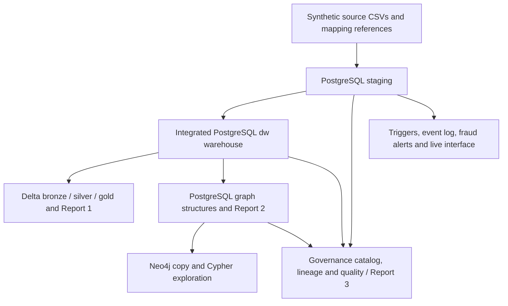

# Horizon Retail Bank

An educational banking data-integration prototype for 32113 Advanced Databases. Synthetic core-banking, card-processing and digital-banking records use different identifiers and formats. The implemented pipeline loads these records into PostgreSQL staging, resolves customers using the supplied mapping reference, builds a shared dimensional warehouse, and supports activity analysis, connected-entity investigation, governance checks and live demonstration alerts.

The objectives demonstrated by the code are a common customer view, traceable activity across three sources, relationship analysis, cataloguing/lineage/quality controls, and observable changes in staging. Supplied fraud labels and planted scenarios are demonstration data, not confirmed fraud or predictive-model results.

## Implemented architecture



The live path watches **staging**, not Delta changes. It does not continuously propagate changes into the warehouse, graph or lakehouse.

| Technology/component | Purpose and implementation |
| --- | --- |
| CSV datasets | Nine files in [horizon/data](horizon/data): seven banking datasets, `entity_mapping_reference.csv` and `fraud_scenario_reference.csv`. The mapping supplies identity ground truth; this is not learned entity matching. |
| PostgreSQL staging and warehouse | [horizon/maedeh](horizon/maedeh), scripts `01`, `02`, `02b`, `03`, `04`, `05`: schemas, eight staging tables (including mapping), server-side CSV import, seven warehouse tables, integrated load and validation. |
| Delta Lake, PyArrow, DuckDB and psycopg 3 | [Raj's implementation](horizon/raj/README_LAKEHOUSE_IMPLEMENTATION.md): read-only warehouse export, typed activity validation, Delta snapshot writes, DuckDB reporting and reconciliation. |
| PostgreSQL graph structures | [horizon/samnang/06_graph_layer.sql](horizon/samnang/06_graph_layer.sql), `06b_import_fraud_scenarios.sql`, `07_report2_connected_entities.sql`: relational node/edge/customer-link/cluster structures and connected-entity views. These are PostgreSQL objects, distinct from Neo4j. |
| Neo4j and Cypher | [08_load_graph_to_neo4j.py](horizon/samnang/08_load_graph_to_neo4j.py) copies PostgreSQL graph structures; [09_report2_neo4j.cypher](horizon/samnang/09_report2_neo4j.cypher) provides visual queries. Uses `psycopg2` and the `neo4j` Python driver. The graph database is Neo4j, not GraphQL. |
| Governance/data fabric prototype | [horizon/shubham](horizon/shubham): `06_governance_setup.sql`, `07_run_governance.sql`, `08_report3_lineage_quality.sql` implement catalogues, classification, lineage, quality rules, masked views and access policies. Samnang's `register_graph_in_governance.sql` registers the graph after governance setup. This is a PostgreSQL governance implementation, not a separate fabric platform. |
| PostgreSQL notifications | [horizon/somit](horizon/somit): `1._create_extension_tcn.sql`, `2._add_pk.sql`, `3._create_trigger.sql` and `listen_lab.py` implement `tcn` change notifications for staging digital users; listener requires `psycopg2`. |
| Live fraud demonstration | [somit/live_lab](horizon/somit/live_lab): `01_live_setup.sql` installs staging triggers, `live_event_log`, `fraud_events` and four rule types; `live_server.py` serves the dashboard and database-polling API using host Python's standard library and Docker/psql. |
| HTML presentation | [generate_dashboard.py](horizon/generate_dashboard.py) reads database sections and writes `horizon/Horizon_Dashboard.html`. It can retain template baseline figures if reads fail; successful file generation does not prove fresh database data. |

The separate [somit/Live Events](horizon/somit/Live%20Events) directory includes replication/publication setup, a Debezium connector configuration and Python fraud/dashboard code. `run_all.ps1` does **not** provision that external streaming stack or execute that route. The integrated live demo instead uses the PostgreSQL triggers in `live_lab`.

## Repository and responsibilities

| Actual location | Contents |
| --- | --- |
| `horizon/data/` | Synthetic source and reference CSVs |
| `horizon/maedeh/` | Warehouse SQL used by the integrated runner |
| `horizon/raj/` | Lakehouse package, scripts, SQL, tests, exported snapshots and recorded outputs |
| `horizon/samnang/` | Graph SQL, Neo4j loader/queries and governance registration |
| `horizon/shubham/` | Governance setup, execution, Report 3 and component README |
| `horizon/somit/` | Notifications, test feeds, `live_lab/` and `Live Events/` |
| `horizon/sql/`, `horizon/python/` | Parallel copies of warehouse/graph scripts; the current PowerShell runner uses owner folders instead |
| `horizon/run_all.ps1`, `horizon/run_all_mac.sh` | Integrated runners; commands below describe PowerShell only |
| `horizon/run_log_*.txt` | Committed historical run evidence, not results of this documentation update |

| Team member | Responsibility and file evidence |
| --- | --- |
| Annika | Overall architecture and report coordination (team allocation; no dedicated folder/report artifact establishes this ownership in the inspected repository). |
| Divaakar | Source systems and synthetic data (team allocation; `horizon/data/` exists, but no dedicated source-generation folder/script verifies authorship). |
| Maedeh | Integrated warehouse; supported by `horizon/maedeh/` and runner step labels. |
| Raj | Delta lakehouse, SQL consolidation and Report 1; supported by `horizon/raj/`. Consolidation has a missing prerequisite described below. |
| Samnang | Graph database and Report 2; supported by `horizon/samnang/`. Conceptual/logical model responsibility is team allocation; model deliverables were not identified here. |
| Shubham | Data fabric/governance and Report 3; supported by `horizon/shubham/`. |
| Somit | Event notifications, live alerts, testing and demonstration; notification/test/live implementation exists in `horizon/somit/`. A completed team demonstration video or comprehensive test sign-off was not identified. |

Folder names and comments support workstream ownership, not authorship of every integration edit. Dashboard/runner integration ownership is not conclusively established by the files alone.

## External lab prerequisites and placement

The shared lab **is external to this repository**: its `docker-compose.yml` is not supplied here. Use the course lab with Compose services named `postgres` and `python`, and Neo4j if running its loader. The Python service must share the lab network and mount `<LAB_PATH>\workspace` at `/workspace`. PostgreSQL must provide the target database (default `lab`), the expected lab role and permissions for schema/role/extension setup, including the `tcn` extension. CloudBeaver is useful for SQL inspection; its actual host port comes from your lab Compose file.

Required tools: Docker Desktop/Engine with Compose v2, PowerShell, and host Python 3 for the live server. The lab Python image must support the pinned lakehouse libraries and already provide `psycopg2` and `neo4j` for the other components. The runner checks only imports for Raj's four libraries and installs pins if an import is missing; it does not verify existing versions or install all team dependencies. First-time installation requires package-network access.

Place the **inner** `horizon` directory from this repository at `<LAB_PATH>\workspace\horizon`. Expected layout:

```text
<LAB_PATH>/docker-compose.yml
<LAB_PATH>/workspace/horizon/run_all.ps1
<LAB_PATH>/workspace/horizon/data/
<LAB_PATH>/workspace/horizon/raj/
```

Avoid `workspace\horizon_retail_bank\horizon` or `workspace\horizon\horizon`. The runner resolves Compose exactly two directories above itself and checks `/workspace/horizon/run_all.ps1` in the Python container. Raj's own `compose.yaml` is a separate component environment, not the missing shared lab Compose file.

Connection details are lab-specific. The runner hard-codes its PostgreSQL role and constructs a default lab DSN; graph/listener/server files also contain lab defaults. Match your provisioned lab to those expectations before running. `-Database` changes the database, not the username/password. This documentation deliberately omits embedded passwords. Do not paste real credentials into committed files or shared logs.

## Full build (PowerShell)

**This rebuilds data; read the reset effects below first.** Replace `<LAB_PATH>` with your external lab directory. Commands run on the host:

```powershell
Set-Location '<LAB_PATH>'
docker compose -f .\docker-compose.yml up -d
powershell -NoProfile -ExecutionPolicy Bypass -File .\workspace\horizon\run_all.ps1
```

The runner resolves running container IDs from Compose service names, copies data/owner SQL into PostgreSQL, then executes warehouse → PostgreSQL graph → governance (including graph registration) → notification/alert setup → Raj export/build/report/verify/history → Neo4j load → dashboard generation. It stops on a nonzero command exit and records output in `workspace\horizon\run_log_<yyyyMMdd_HHmmss>.txt`. A script returning zero is not always proof that its printed checks passed: inspect the results, especially Neo4j's printed `RESULT`.

Supported switches: `-SkipRaj`, `-SkipNeo4j`, `-SkipStreaming`, `-SkipDashboard`, `-Database <DATABASE_NAME>`. For example:

```powershell
powershell -NoProfile -ExecutionPolicy Bypass -File .\workspace\horizon\run_all.ps1 -SkipNeo4j -Database '<DATABASE_NAME>'
```

Every invocation still performs the PostgreSQL reset, even with skip switches. `-SkipRaj` can also leave the dashboard missing its psycopg dependency if the lab image lacks it.

### Reset and overwrite effects

[00_reset_all.sql](horizon/00_reset_all.sql) executes `DROP SCHEMA ... CASCADE` for `secure`, `governance`, `graph`, `dw`, `staging`. It removes all objects/data in those schemas, including live logs, alerts and manual/demo changes. **CASCADE can also remove dependent objects outside those schemas**; it is not an unconditional guarantee that other lab work is untouched. Cluster-wide governance roles are retained/reused. The runner then reconstructs its schemas from the committed inputs; unrelated manual additions are not recoverable from those CSVs.

The runner deletes/replaces `/tmp/horizon_data` and `/tmp/horizon_sql` in PostgreSQL. Governance setup independently drops/recreates its schemas. Raj exports replace seven CSV snapshots and handoff metadata; Delta writes overwrite each table's current snapshot, and JSON/CSV/HTML report evidence is replaced. Neo4j loading deletes **all nodes labelled `:Node` and their relationships**, then reloads them; this label is not uniquely scoped to Horizon. Dashboard generation replaces `Horizon_Dashboard.html`. Each integrated run creates a new dated log.

## Dashboards, reports and live behaviour

After a successful full build, open the generated static pages:

```powershell
Start-Process .\workspace\horizon\Horizon_Dashboard.html
Start-Process .\workspace\horizon\raj\output\warehouse\reports\Report_1_Activity_Brief.html
```

Generate the main dashboard again without resetting PostgreSQL:

```powershell
$Py = (docker compose -f .\docker-compose.yml ps -q python).Trim()
$Pg = (docker compose -f .\docker-compose.yml ps -q postgres).Trim()
docker exec -e PGHOST=postgres -e PGDATABASE=lab $Py python /workspace/horizon/generate_dashboard.py
```

`generate_dashboard.py` uses database reads where available, but individual failed sections can retain baseline/template values. Check its console messages (`read from PostgreSQL`, `skipped`, `team-run figures`). Opening HTML alone does not start a listener or alert server. The template also contains a replay fallback; replay is not evidence of a live database event.

| Report | Generate/inspect |
| --- | --- |
| Report 1 | Raj's script `04_report_activity_trends.py --mode warehouse`; see [component commands](horizon/raj/README_LAKEHOUSE_IMPLEMENTATION.md#run-only-rajs-component-powershell). Both `Report_1_Activity_Brief.html` and `Report_1_Activity_Trends.html` contain the generated page; CSV/SVG/metrics accompany them. |
| Report 2 | Runner executes `samnang/07_report2_connected_entities.sql`. Inspect its `R2`/view queries in PostgreSQL via CloudBeaver or psql. For Neo4j, open [Neo4j Browser](http://localhost:7474) only if that port is published by your external lab; run `samnang/09_report2_neo4j.cypher` with your lab credentials. |
| Report 3 | Runner executes `shubham/08_report3_lineage_quality.sql`; run its R3.1–R3.15 queries against the governance/secure schemas. These are SQL report results, not a separately generated Report 3 HTML file. |

### Live alert interface

Run on the **host**, from the lab directory, after loading the warehouse. Keep the terminal open:

```powershell
$env:HZ_DB = 'lab'
$env:HZ_CONTAINER = (docker compose -f .\docker-compose.yml ps -q postgres).Trim()
$env:HZ_PORT = '8765'
$env:HZ_TZ = 'Australia/Sydney'
python .\workspace\horizon\somit\live_lab\live_server.py
```

Open [http://localhost:8765](http://localhost:8765), chapter G. No Docker port mapping for 8765 is needed because the server runs on the host and binds `127.0.0.1`. It invokes Docker/psql, installs/reinstalls live triggers, serves the generated dashboard (or template fallback), and provides `/api/state` plus test-action endpoints. The browser polls state roughly every second. Four rule types cover overseas card clusters, rapid approved-card bursts, shared-device rings and suspicious beneficiaries. Actual predicate details are in `01_live_setup.sql`; these are demonstration rules with source-field assumptions.

**Port coupling:** although the server accepts `HZ_PORT`, the current dashboard's `liveBases()` discovers only port **8765** (localhost/127.0.0.1). Keep 8765 free for the supplied interface. Changing only `HZ_PORT` will not make the dashboard connect to the new port. Stop a conflicting process before starting it; this documentation update does not change frontend configuration.

Test buttons execute SQL and change staging; cleanup is in `somit/live_lab/02_clean_tests.sql`. Such changes do not automatically refresh downstream warehouse/lakehouse data. Stop with Ctrl+C. This local server has no production authentication boundary and is intended for the lab demonstration.

For the independent `tcn` notification listener (not the alert API), in a separate window:

```powershell
$Py = (docker compose -f .\docker-compose.yml ps -q python).Trim()
docker exec -it -e PGDATABASE=lab $Py python /workspace/horizon/somit/listen_lab.py
```

In another window, use the SQL already copied by the full runner, observing notifications:

```powershell
$Pg = (docker compose -f .\docker-compose.yml ps -q postgres).Trim()
docker exec $Pg psql -U student -d lab -v ON_ERROR_STOP=1 -f /tmp/horizon_sql/somit/insert_test_live_feed.sql
docker exec $Pg psql -U student -d lab -v ON_ERROR_STOP=1 -f /tmp/horizon_sql/somit/update_test_live_feed.sql
docker exec $Pg psql -U student -d lab -v ON_ERROR_STOP=1 -f /tmp/horizon_sql/somit/delete_test_live.sql
```

Finish with deletion to remove test users. For a nondefault database, substitute its name consistently in the commands/environment.

## Validation and evidence

| Component | Evidence and interpretation |
| --- | --- |
| Warehouse | `maedeh/05_validation_checks.sql`, staging/warehouse row counts, missing-reference and monetary comparisons in dated run logs. |
| Graph | Counts and Report 2 SQL results; Neo4j loader's node/edge/link comparisons and explicit `RESULT: MATCH`. Counts alone do not validate all properties. |
| Governance | `governance` catalog/lineage/DQ runs and Report 3 queries; distinguish data-quality FAIL findings from execution ERRORs. Solo-run expected values can differ from integrated-run values and date-dependent rules. |
| Lakehouse | `raj/output/warehouse/build_summary.json`, `verification.json` (16 checks), `delta_history.json`, `lakehouse/manifest.json`, Delta audit table and reports. See detailed README for scope. |
| Notifications/live alerts | Listener output; `staging.live_event_log`, `staging.fraud_events`, `/api/state`, and rule-error entries. Observe actual test insertions rather than replay. |
| Integrated run | New `run_log_*.txt`, failed-step names and completion message; skipped steps remain unvalidated. Committed logs are historical evidence only. |

No lab build, database connection, live test or fresh reconciliation run was performed as part of this documentation change. Recorded outputs are baseline observations, not universal targets.

## Troubleshooting and limitations

| Problem | Check |
| --- | --- |
| Compose file missing / wrong nesting | `run_all.ps1` must be exactly `<LAB_PATH>\workspace\horizon\run_all.ps1`; external Compose belongs at `<LAB_PATH>\docker-compose.yml`. |
| Docker/container not running | Start Docker Desktop, then `docker compose -f .\docker-compose.yml up -d`; inspect `docker compose ps` and service logs. |
| Python cannot see files | Verify the external mount maps lab `workspace` to `/workspace`; `docker exec $Py test -f /workspace/horizon/run_all.ps1`. |
| COPY file missing/permission denied | Confirm all nine CSVs and runner copy/chmod steps; server-side COPY reads `/tmp/horizon_data`, not a Windows host path. |
| Authentication/wrong database | Verify provisioned lab role, database, container networking and script defaults. `localhost` inside Python is not the PostgreSQL service. Several scripts hard-code lab authentication; `-Database` alone cannot adapt those credentials. |
| Missing imports/install failure | Lakehouse pins are in `raj/requirements.txt`; check `psycopg2`/`neo4j` separately. The external image, Python compatibility and package-network access are prerequisites. |
| Port conflict | Check external Compose mappings for PostgreSQL/Neo4j/CloudBeaver. Host live UI specifically requires available 8765 with the current frontend. |
| Governance/graph results missing | Preserve runner order: governance setup resets its schemas, then graph registration and governance cycle must run. |
| Lakehouse input changed | Re-export, rebuild, regenerate Report 1, then verify. Do not treat committed CSVs as a fresh export. |

Scope remains synthetic, finite snapshots. Identity mapping is supplied; lakehouse activity counts can include multiple records for one operation, and digital currency is unspecified. No unstructured ingestion, continuous warehouse-to-Delta CDC, distributed cross-table transaction or production fraud-detection service is demonstrated. Raj's SQL inventory requires missing `horizon/raj/team_sql/order.json`; existing unit tests require an uncommitted dataset-preview handoff. See the detailed lakehouse README.

Preserved component references: [Raj's original README](horizon/raj/README.md), [warehouse notes](horizon/maedeh/README_maedeh.txt), [graph notes](horizon/samnang/README_graph.txt), [governance notes](horizon/shubham/README_governance.md), [live lab notes](horizon/somit/live_lab/README_live_lab.md), [older integrated notes](horizon/README_INTEGRATED.txt), [older lab notes](horizon/README_LAB.txt). Older notes contain historical scope/counts and machine-specific examples; use the current implementation and the commands above when they differ.
